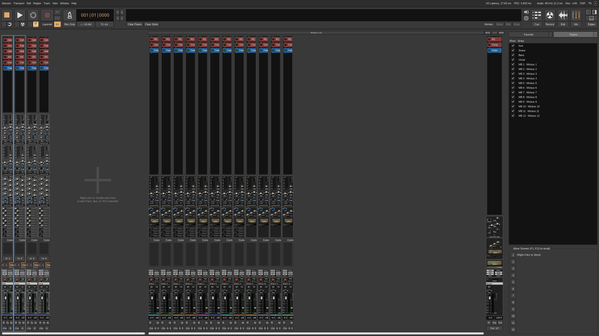
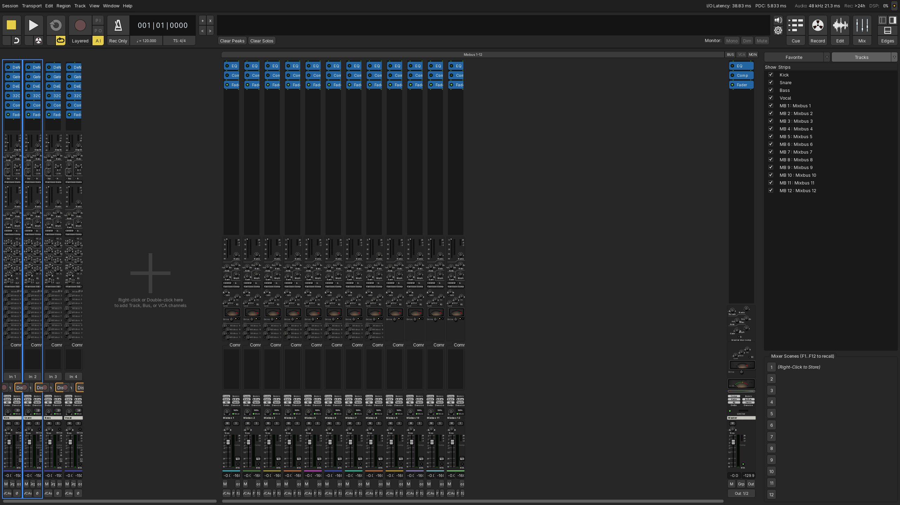

# Dark Studio theme for Mixbus 12.1

A darker, flatter look for the whole Harrison Mixbus 12.1 interface: deep grey background, blue plugin lists, grey knobs, quiet section borders and the Adwaita Sans font.

It is made only of configuration files: no code change, no rebuild. It works with the stock Mixbus 12.1 and with patched builds.

**Stock Mixbus theme**



**Dark Studio**



Both screenshots show the same session in landscape format (2560 × 1440, 16:9), with Kick and Snare selected, the same four tracks, twelve mixbuses and master, and the gate, compressor, EQ and send sections visible. Both use the same mixer strip scale (50%); each theme keeps its own font and interface styling. Click either image to inspect it at full size.

## Files

| File | Role |
| --- | --- |
| `my-dark-mixbus-12.1.colors` | Colour palette: the user override of the stock *dark-mixbus* theme, with its own `studio:` colour groups |
| `dark-studio.rc` | Widget style for menus, buttons, lists and text, based on the stock `clearlooks.rc` |
| `install-theme.sh` | Installs both files into `~/.config/mixbus12` and sets the matching interface options |

## Install

Close Mixbus, then:

```sh
git clone https://github.com/philhurtu99/mixbus-dark-studio-theme.git
sh mixbus-dark-studio-theme/install-theme.sh
```

The script:

1. backs up any existing theme files and `ui_config` to `~/.config/mixbus12/appearance-backups/<date>/`;
2. copies `my-dark-mixbus-12.1.colors` and `dark-studio.rc` into `~/.config/mixbus12`;
3. sets four interface options and leaves every other setting alone: style file `dark-studio.rc`, font *Adwaita Sans*, font scale 114 %, flat region gradients.

Keep the *dark-mixbus* colour theme selected in **Preferences > Appearance**. Adwaita Sans must be installed; otherwise GTK falls back to the default font.

## Uninstall

Restore the files saved in `~/.config/mixbus12/appearance-backups/<date>/`, or delete `my-dark-mixbus-12.1.colors` and `dark-studio.rc` from `~/.config/mixbus12` and pick another style and theme in **Preferences > Appearance**.

## Notes

Built and tested on Linux with Mixbus 12.1. This is an unofficial theme, not affiliated with Harrison. No Mixbus program files are included.
